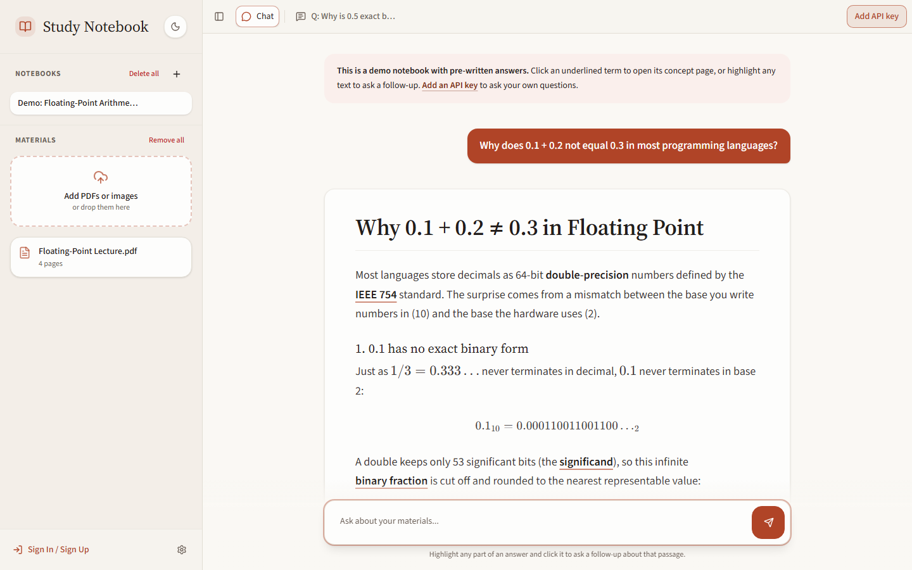
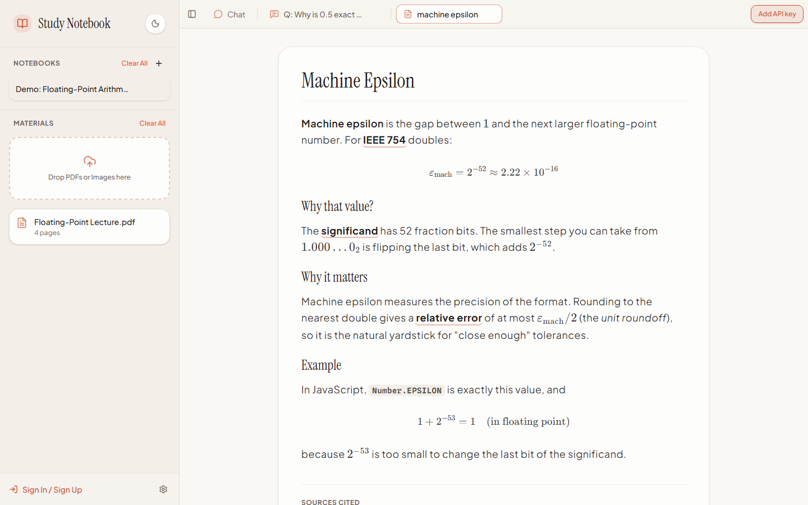
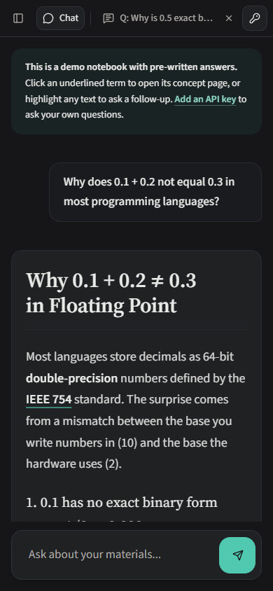
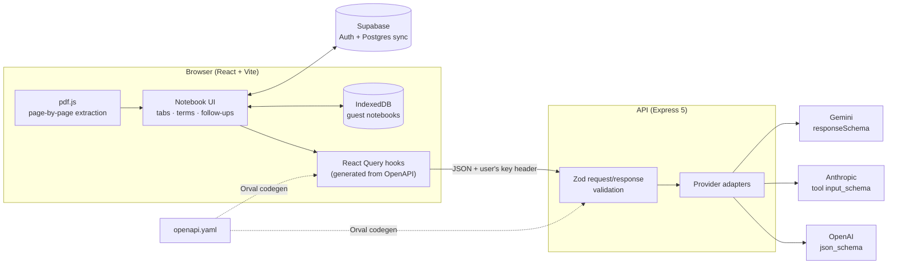

# Study Notebook AI

[](https://github.com/Tofaluu/study-notebook-ai/actions/workflows/ci.yml)
[](LICENSE)

**An AI study notebook that turns lecture PDFs into explanations you can explore.** Every answer underlines the jargon it uses; click a term and it opens as its own beginner-friendly page, which links to the concepts *it* depends on. Highlight any sentence to ask a follow-up about just that passage. Answers cite the exact lecture page they came from.

**[Try the live app →](https://study.thomasliu.dev)** No sign-up or API key needed; a sample notebook loads on your first visit.



<table>
  <tr>
    <td width="62%"></td>
    <td width="38%"></td>
  </tr>
  <tr>
    <td align="center"><sub>Clicking a term opens a concept tab with its own prerequisites</sub></td>
    <td align="center"><sub>Responsive, with light and dark themes</sub></td>
  </tr>
</table>

## Features

- **Clickable concepts.** The model returns the technical terms it used alongside its answer. The client underlines them, and clicking one opens a dedicated explanation tab. Concept pages list their own prerequisite terms, so you can drill down as far as you need.
- **Highlight-to-ask follow-ups.** Select any text in an answer (math included; KaTeX is converted back to readable text) and ask a question scoped to that passage. Each follow-up opens in its own tab, nested under the concept page it came from.
- **Grounded in your lectures.** PDFs are parsed page by page in the browser, so every citation points to a real source and page number.
- **Three providers, one contract.** Choose models from OpenAI, Anthropic, or Google Gemini. All three return the same validated JSON shape.
- **Bring your own key.** API keys stay in your browser and are forwarded per request; the server never stores them.
- **Notebooks that sync.** Use it as a guest (stored locally in IndexedDB), or sign in to sync notebooks across devices with Supabase.
- **A workspace, not a chat log.** Draggable, resizable, renamable tabs; multiple notebooks; custom themes; and a mobile layout with touch drag-and-drop.

## Architecture



### Design decisions

- **One OpenAPI spec is the source of truth.** [`lib/api-spec/openapi.yaml`](lib/api-spec/openapi.yaml) generates both the typed React Query hooks the frontend calls and the Zod schemas the server validates with, so client and server can't drift apart.
- **A provider adapter per vendor.** Each vendor enforces structured output differently: OpenAI uses `json_schema` with `strict: true`, Anthropic uses a tool whose `input_schema` is the response schema (with a fallback when the model answers in plain text), and Gemini uses a `responseSchema` (which rejects `additionalProperties`, so it is stripped). Each adapter in [`artifacts/api-server/src/llm`](artifacts/api-server/src/llm) implements the same `buildRequest` / `extractText` interface, so adding a provider doesn't touch the routes.
- **Validate, then repair, then validate again.** Models occasionally drift from the requested shape, for example by returning a string instead of an array or echoing the schema itself. [`normalizeExplanation`](artifacts/api-server/src/llm/normalize.ts) repairs the known failure modes before a strict Zod parse, and provider errors come back as readable answers instead of 500s.
- **The page is the unit of citation.** Text is extracted per page in the browser and sent as `[SOURCE id | name | PAGE n]` blocks within a 180k-character budget, so the model can only cite pages that actually exist.
- **A demo that costs nothing to run.** The first-visit notebook ships with pre-generated answers and a closed set of linked concept pages, served from the client without calling any model.

## Tech stack

| Layer | Tools |
|---|---|
| Frontend | React 19, TypeScript, Vite, Tailwind CSS 4, Radix UI, TanStack Query, react-markdown + KaTeX, pdf.js |
| Backend | Node.js 24, Express 5, Zod |
| API contract | OpenAPI 3 + Orval (generated React Query hooks and Zod schemas) |
| Data | IndexedDB (guest), Supabase Auth + Postgres (signed-in sync) |
| AI providers | OpenAI, Anthropic, Google Gemini |
| Testing & CI | Vitest, Playwright, GitHub Actions |
| Tooling | pnpm workspaces monorepo |

## Project structure

```
artifacts/
  api-server/        Express API: routes, provider adapters, prompts, tests
  concept-graph/     React app: notebook UI, demo notebook, Playwright e2e tests
lib/
  api-spec/          openapi.yaml + Orval config (source of truth)
  api-zod/           generated Zod schemas used by the server
  api-client-react/  generated React Query hooks used by the client
```

## Running locally

Requires Node.js 24 and pnpm.

```bash
pnpm install

# Supabase publishable keys for the frontend
cat > artifacts/concept-graph/.env.local <<EOF
VITE_SUPABASE_URL=https://your-project.supabase.co
VITE_SUPABASE_ANON_KEY=your-publishable-key
EOF

pnpm run dev           # API on :3000, web app on :5173 (proxies /api)
```

Open http://localhost:5173. The demo notebook works immediately; add an OpenAI, Anthropic, or Gemini key under **Settings → API Keys** to ask your own questions.

## Testing

```bash
pnpm run typecheck     # all packages
pnpm run test          # Vitest: provider adapters, normalization, API routes
pnpm run test:e2e      # Playwright: demo flow on desktop and mobile
```

Regenerate the client hooks and server schemas after editing the spec:

```bash
pnpm --filter @workspace/api-spec run codegen
```

## License

[MIT](LICENSE)
